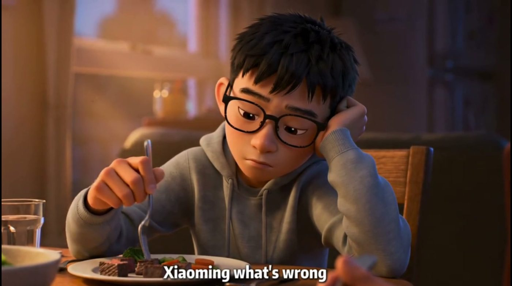
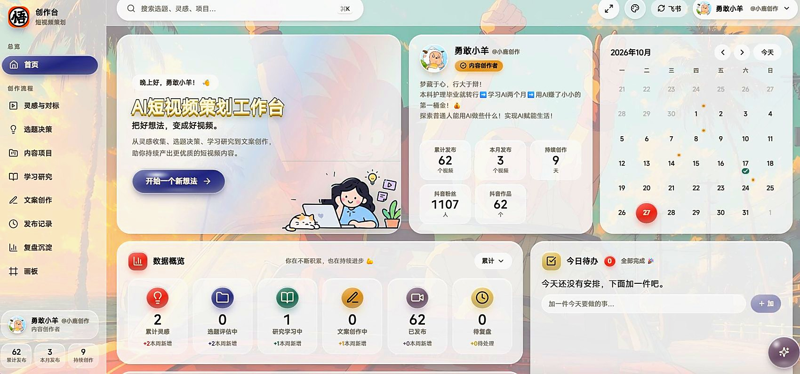
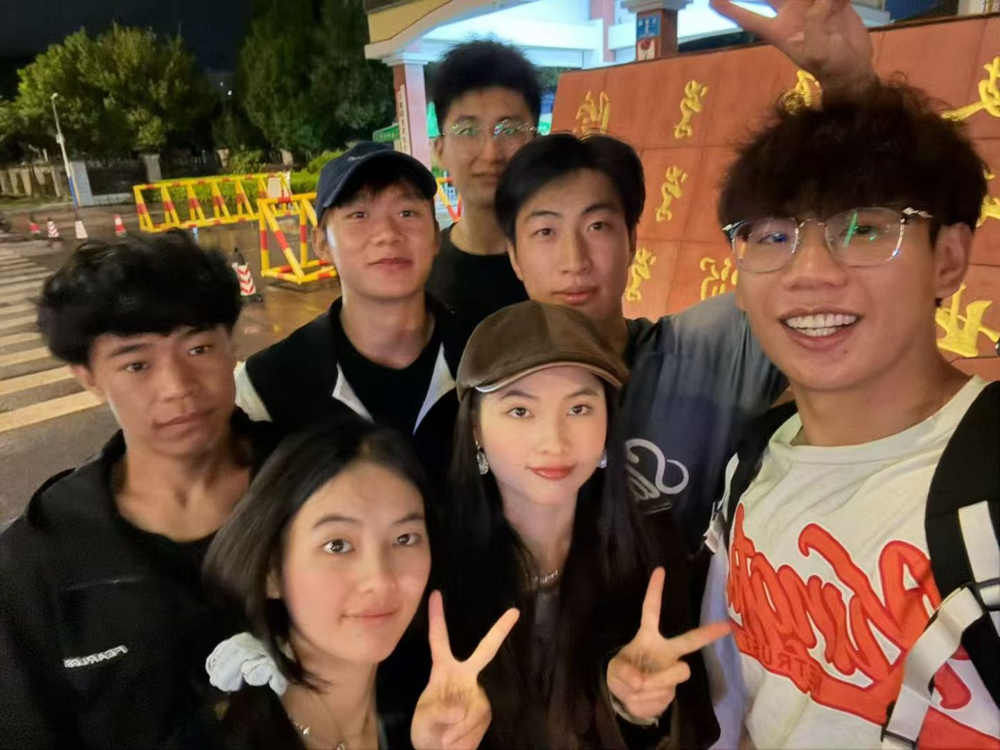

# 杨富超 · 个人网站（静态站）

纯静态 HTML + CSS + 原生 JS，无构建步骤、无依赖。双击 `index.html` 就能看。

## 页面

| 文件 | 页面 | 路由建议 |
|---|---|---|
| `index.html` | 首页 | `/` |
| `about.html` | 关于我 | `/about` |
| `experience.html` | 经历与项目 | `/experience` |
| `skills.html` | 技能工具 | `/skills` |
| `works.html` | 作品展示 | `/works` |
| `awards.html` | 荣誉证书 | `/awards` |
| `friends.html` | 死党们 | `/friends` |
| `contact.html` | 联系我 | `/contact` |

## 目录

```
site/
├─ index.html … friends.html
├─ assets/
│  ├─ css/style.css     全站样式（设计变量集中在 :root）
│  ├─ js/main.js        移动端菜单 / 筛选 / 复制邮箱
│  └─ img/              放图片的地方，见 img/README.md
└─ README.md
```

## 本地预览

直接双击 `index.html`。`file://` 下所有交互都可用（无 fetch、无模块导入）。

想用本地服务器：

```bash
cd site
python -m http.server 8080
# 打开 http://localhost:8080
```

## 上线

整个 `site/` 目录原样上传即可，任意静态托管都行。四个免费方案的完整步骤见 `DEPLOY.md`。

| 方案 | 地址 | 特点 |
|---|---|---|
| Cloudflare Pages（推荐） | `xxx.pages.dev` | 无限带宽、自定义域名、自带 HTTPS |
| Vercel | `xxx.vercel.app` | 最省事，拖文件夹即可 |
| GitHub Pages | `xxx.github.io` | 完全免费，但国内偶尔打不开 |
| 腾讯云 COS / 阿里云 OSS | 自有域名 | 国内最快，但要 ICP 备案 |

如果要走 `/about` 这类无后缀路由，需要在托管侧配置重写规则（`/about` → `/about.html`）。不做也行，直接用 `about.html` 链接。

仓库里已经备好：`404.html`（走丢页）、`_headers`（静态资源长缓存 + HTML 不缓存）、`robots.txt`、`sitemap.xml`（上线后把域名换掉）。

## 图片位置

图片已全部接入，目录与用途见 `assets/img/README.md`。三类写法：

```html
<!-- 1. 页头实拍背景：给 section 加 is-filled，.hero__photo 用内联 background-image -->
<section class="hero hero--sm is-filled">
  <div class="hero__photo" style="background-image: url('assets/img/hero-works.jpg')"></div>

<!-- 2. 作品卡封面：.work__img 铺满，object-fit: cover -->
<div class="work__cover">
  

<!-- 3. 没有实拍封面的卡：用字标，不假装有图 -->
<div class="work__cover work__cover--c">
  <div class="work__mark"><b>OZON</b><span>五金类目</span></div>
```

浅色后台截图（`ui-studio-*.jpg`）在卡片里加 `is-ui` 类会自动压暗一档：

```html

```

白天拍的实拍封面（`book.jpg`）加 `work__img--book`，压到 0.85，不然在深色网格里会跳出来。

`.ph` 占位样式还留在 CSS 里，新加空位仍可用：

```html
<div class="ph" data-asset="C4"><span class="ph__t">封面待补　810×452</span></div>
```

竖版截图（账号后台）不要塞进 16:9 的卡片封面，用 works 页的手机样机结构：

```html
<div class="phone">
  <div class="phone__screen"></div>
  <div class="phone__cap"><b>TIKTOK</b><span>1.5 万粉丝</span></div>
</div>
```

## 设计变量

全部在 `assets/css/style.css` 顶部的 `:root`：

```css
--bg: #08090c;      /* 页面底色 */
--red: #e0242f;     /* 唯一强调色 */
--text-2: #f7f4ef;  /* 主标题 */
--muted: #9a9da4;   /* 次级文字 */
--pad: 96px;        /* 内容区左右留白 */
```

改一处全站生效，不要在各页面里写死颜色。

## 字体

| 用途 | 字体栈 | 说明 |
|---|---|---|
| 大标题（毛笔） | `BrushCN` → `华文行楷` → `楷体` | 自托管子集，见下 |
| 区块标题 / 大数字 | `Source Han Serif SC` → `Noto Serif SC` → `SimSun` | 装了就自动用思源宋体 |
| 正文 | `Noto Sans SC` → `PingFang SC` → `Microsoft YaHei` | 系统字体即可 |
| 小标签 / 编号 | `Inter` → `SF Mono` → 等宽 | 只用于 10–15px 的技术感标签 |

### 毛笔字体（标题专用）

`assets/fonts/brush-subset.woff2`（约 27 KB / 70 字形），是 `Ma Shan Zheng` 的**子集**：

- 只包含站点里实际用到的字：`hero__title` / `hero__quote` / `hero__hand` / `hand-note`
- `@font-face` 在 `style.css` 顶部，字体栈变量 `--brush`
- 细笔画靠 `-webkit-text-stroke: 2.2px currentColor` 加粗，改字号时描边一起微调

**改了标题文案必须重建子集**，否则新字会回落到行楷：

```bash
python _media/build_font.py     # 扫七页 HTML → 向 Google Fonts 要子集 → 覆盖 woff2
```

大数字（`.stat__n`、`.bar__top b`、`.statline b`）走宋体，**不要**用 `--num`：等宽字体里逗号、小数点的字宽等于数字，`33.2` 会裂成 `33 . 2`。

## 交互

- 移动端（≤860）汉堡菜单，点空白处收起
- 「经历与项目」「作品展示」的分类筛选，纯前端过滤，无跳转；经历页筛选后会收起空掉的年份章节
- 「联系我」复制邮箱，带 toast 提示
- 页脚年份自动取当前年
- 经历页时光轴：红线随滚动生长，读到哪年哪年亮
- 首页跑马灯：数字与说明拆开写，数字用白色加粗、说明用灰字，深色底上一眼能看见（原来用的是描边灰字，几乎看不见）
- 作品页大屏轮播：自动走片（6.8s 一张），点标签 / 点箭头 / ←→ 键 / 手机左右滑都能切
- 荣誉页证书环绕：拖动 / 点箭头 / 点圆点 / ←→ 键切换，点中间那张开大图（Esc 关闭）
- 死党页照片墙：点任意一张开大图，←→ 翻页、Esc 关闭，底部显示「第几张 / 共几张」；四个分类筛选后翻页只走当前可见的那几张
- 成片播放：作品页轮播按钮、作品卡封面、首页「最新成片」海报都能直接放片子，Esc 关闭时视频同时暂停

## 动效层

全部在 `assets/js/main.js` 后半段，靠 data 属性驱动，不写死任何页面：

| 属性 | 效果 |
|---|---|
| `data-reveal` | 元素进入视口时上浮淡入，`data-reveal="blur"` 带模糊 |
| `data-reveal-group` | 容器进入视口后，**直接子元素**依次入场（每个错开 80ms） |
| `data-count="500"` | 数字从 0 滚到 500，`data-dec="1"` 保留一位小数，`data-dur` 改时长 |
| `data-bar="0.0664"` | 进度条从 0 长到 6.64%，值写 0–1 |

```html
<div class="stats__grid" data-reveal-group>
  <article class="stat">
    <div class="stat__n"><span data-count="500">500</span><span class="stat__u">万+</span></div>
  </article>
</div>
```

另外两件由脚本自动注入、不用改 HTML：

- 顶部 2px 红条＝阅读进度，跟着 `scrollY / 可滚动高度` 走

**兜底**：`<head>` 里那行 `classList.add("js")` 是总开关，脚本没跑起来时 CSS 的隐藏规则不生效，内容照常全显示。数字滚动另有 `setTimeout` 兜底，标签页被挂起也不会停在 0。系统开了「减弱动态效果」时，所有动画直接跳过、数字直接给终值。

行内强调用 `.hl`，只给关键数字上色（红），一屏最多两三处：

```html
<p>起号 1 个月内单条最高 <span class="hl">500 万+</span> 播放。</p>
```

## 经历时间轴（时光轴）

经历按年份分章，竖线是时间本身：滚动时红线从顶部往下长，读到哪一年、哪一年的数字就亮起来。

```html
<div class="tl-wrap" data-timeline>
  <span class="tl__rail" aria-hidden="true"><i data-tl-fill></i></span>

  <ol class="tl">
    <!-- 章节：年份做成大字，右边跟章节名 -->
    <li class="tl__year" data-year-group="2025">
      <b class="tl__y">2025</b>
      <span class="tl__yl"><i>CHAPTER 02</i>走进真实现场</span>
    </li>

    <!-- 条目：左列时间 + 中间圆点 + 右侧内容 -->
    <li class="tl__item" data-cat="intern" data-reveal>
      <div class="tl__when"><b>2025.06 — 2026.04</b><span>实习</span></div>
      <span class="tl__dot"></span>
      <div class="tl__body">
        <h3>昆明市中医医院 <em>护理实习生</em></h3>
        <p class="tl__d">一句话写清做了什么、结果如何。</p>
        <ul class="tl__tags"><li>临床</li><li>轮转十个月</li></ul>
      </div>
    </li>
  </ol>
</div>
```

- **加一条经历**：在对应年份章节下插一个 `li.tl__item`，`data-cat` 填 `edu / intern / work`，筛选按钮靠这个值过滤
- **加一个年份**：插一个 `li.tl__year data-year-group="2027"`，角度和点亮逻辑全自动（靠 `[data-year-group]` 的数量）
- **筛选会自动收起空章节**：比如只看「实习」，2022 和 2026 两个年份会被一起隐藏
- **红线**：`--tl-p`（0–1）由脚本按滚动位置写入，`calc(var(--tl-p) * 100%)` 控制高度；走到底时自动隐藏进度光点（`.is-full`），让结尾的空心圆点成为终点
- 左列宽度由 `--tl-year` 控制（桌面 268px，≤900 归零并把时间挪到标题上方）

## 作品大屏轮播（作品页）

顶部三张精选作品自动轮播，下面接「全部作品」九宫格与分类筛选。

```html
<div class="stage" data-stage>
  <div class="stage__vp" tabindex="0" role="region" aria-label="精选作品轮播">
    <article class="stage__slide is-on" data-slide>
      <div class="stage__bg" style="background-image: url('assets/img/video-01.jpg')"></div>
      <div class="stage__shade"></div>
      <div class="stage__in">
        <div class="stage__copy">…类型 / 标题 / 一句话 / 标签…</div>
        <div class="stage__stat"><b>33.2<i>万</i></b><em>单条最高播放</em></div>
      </div>
    </article>
    <!-- 每张一份 -->
  </div>

  <div class="stage__bar">
    <ol class="stage__tabs" role="group">
      <li><button class="stage__tab is-on" data-go="0" aria-pressed="true"><b>01</b><span>护理科普</span><i></i></button></li>
    </ol>
    <div class="stage__nav"><button class="stage__arrow" data-prev>…</button><button class="stage__arrow" data-next>…</button></div>
  </div>
</div>
```

- **加一张**：复制 `article.stage__slide` 与对应 `button.stage__tab`，两边的顺序必须一致（`data-go` 从 0 数），编号 01/02/03 是写死的文案
- **自动播放**：6.8s 一张，进度写进当前按钮的 `--stage-p`，用 `scaleX` 画成下划线；悬停、聚焦、切到别的标签页都会暂停，鼠标环境才绑这些（触屏绑了会因 focus 卡在暂停态）
- **遮罩**：`stage__shade` 是「底部压黑 + 左侧压黑」双层渐变，保证任何底图上的字都读得清；右下角再叠一层径向暗角托住大数字
- **界面截图当底图**：加 `.stage__slide--ui`，会先 `brightness(.8)` 再叠更强的遮罩，否则白底会把字顶掉
- **≤860 改成上图下文**：图固定 220px 在顶部，字块落在下面的实底上（232px），不再压在图片上；标签只留编号，左右箭头隐藏（手指滑）
- 件数用 `data-works-count`，**不要**用 `data-count`——后者是数字滚动的保留属性，会被动画改成 0 再往上滚

## 证书环绕（荣誉页）

九张证按 `360° / n` 均分在 3D 环上，中间那张凸起 26px 并全亮，两侧渐暗后退：

```html
<section class="cert-wall section cert-ring" data-cert-ring>
  <div class="wrap">
    <div class="sec-head">
      <div class="sec-head__l">…标题…</div>
      <div class="ring-nav">← →</div>
    </div>
  </div>

  <div class="ring-stage" data-ring-stage>
    <div class="ring" data-ring>
      <figure class="ring__card" data-i="0">
        <div class="ring__img"></div>
        <figcaption><b>2022.09</b>军事技能训练 优秀学员</figcaption>
      </figure>
      <!-- 每张一份，顺序＝环绕顺序 -->
    </div>
  </div>

  <div class="wrap ring-foot">
    <div class="ring-dots" data-ring-dots></div>
    <p class="ring-count" data-ring-count>01 / 09</p>
    <p class="ring-hint">每张都可点开看原件</p>
  </div>
</section>
```

- **加/减证**：直接增删 `figure.ring__card`，角度、圆点、计数全部跟着 `cards.length` 算，不需要改 JS
- **竖版证书不裁切**：`object-fit: contain` + 同一张图的 `blur(18px)` 衬底，横框里也不会留黑边
- **只有中间那张显示说明**，两侧的 `figcaption` 隐藏，画面更干净
- **≤900 自动退化**为横排滑动条：3D 关掉、箭头隐藏、文案换成「左右滑动」，点任意一张看大图
- 自动轮播 4.2s；悬停、离开视口、拖拽时暂停；拖动超过 40px 才翻页，避免误触

## 成片播放（作品页 + 首页 + 技能页）

站内共有六段真片子，点开就能看：

| 文件 | 内容 | 时长 |
|---|---|---|
| `picc-care.mp4` | PICC 置管后居家护理（3D 动画） | 1′38″ |
| `workbench-demo.mp4` | AI 漫剧工作台界面演示 | 1′37″ |
| `short-film-01.mp4` | 想回家的孩子 | 3′07″ |
| `short-film-02.mp4` | 护眼科普短片 | 2′18″ |
| `short-film-03.mp4` | 红围巾的孩子 | 55″ |
| `short-film-04.mp4` | 云上的巨眼 | 29″ |

放在 `assets/video/`，原片是 HEVC 或 12Mbps 高码率，浏览器放不了，站内这些是转码后的 H.264（`+faststart`，可边下边播）。

任何元素加 `data-video` 就能播：

```html
<!-- 触发器 -->
<button type="button" data-video="assets/video/picc-care.mp4"
        data-video-poster="assets/img/video-05.jpg"
        data-video-title="PICC 居家护理动画 · 98 秒 · 3D 动画">播放成片</button>

<!-- 播放层：每个要放片子的页面各放一份 -->
<div class="lightbox lightbox--video" data-video-box aria-hidden="true" role="dialog" aria-modal="true">
  <div class="lightbox__vwrap">
    <video data-video-el controls playsinline preload="metadata" poster="assets/img/video-05.jpg"></video>
    <p class="lightbox__vtitle" data-video-title></p>
  </div>
  <button type="button" class="lightbox__x" data-video-close aria-label="关闭视频">×</button>
</div>
```

- **`preload="metadata"`**：不要写 `none`，否则自动播放被拦时连首帧都没有
- **换片**：改 `data-video` 指向的文件名即可，同一个文件重复点不会重新加载；不同文件会自动换源
- **关掉要暂停**：`close()` 里 `vid.pause()`，不然声音会在弹层关掉后继续放
- **四处入口**：作品页轮播按钮 `.stage__play`、作品卡封面 `.work__cover--btn`、首页精选卡封面、首页成片横条 `.vstrip`；技能页工作台那格是 `.duo__play`
- **没有本地文件的卡片不要放播放按钮**：首页「海外账号从 0 到 1」只有截图没有片子，就把圆圈换成箭头（`.work__play--arrow`），整张卡链到 `works.html#backstage` 看真实数据后台——假播放按钮比没有更糟
- **短片区块** `.films`：四张卡横排（≤1024 两列、≤560 单列），封面是抽帧图，鼠标移上去轻微放大

## 联系页右侧人像

联系页页头换成 3:4 竖版自拍。竖图铺满 1440 宽会把脸裁没，所以右侧单独占 40% 宽，文字留在左边：

```css
.hero--contact .hero__photo { left: auto; width: 40%; background-position: 50% 46%; }
.hero.hero--contact.is-filled .hero__shade { /* 左黑右透的横向渐变 */ }
```

- ≤860 恢复成整幅背景（竖图在手机上反而自然），压暗换成竖向渐变
- 底部渐变过渡在 `.hero--contact .hero__photo::after`，别和下面硬切

## 页头背景（两种版式）

**横图页**（首页 / 技能 / 作品 / 荣誉）：整幅大图铺在首屏。

```css
.hero--home { height: clamp(640px, 84vh, 880px); }
.hero--page { height: clamp(520px, 70vh, 760px); }
.hero--sm   { height: clamp(460px, 62vh, 660px); }
```

- 原来内页页头只有 300–380px，1920×1081 的图被 cover 裁成中间一条；高度放开后只裁上下 7% 左右
- `hero__fade`（底部压黑）同步加高：170 / 150 / 140px，不然图下方会黑一大块
- ≤860 时 `height: auto` + `min-height`（520 / 440），手机上也留够背景面积

**竖图页**（关于我 / 经历与项目 / 死党们 / 联系我）：原图是竖版，铺满宽屏必然裁成一条，改成右侧一块竖着放。

```html
<section class="hero hero--page hero--side is-filled">
  <div class="hero__photo" style="background-image: url('assets/img/hero-exp.jpg')"></div>
  …
</section>
```

- `.hero--side .hero__photo`：`left: auto; width: 38%`，右侧整块；文字留在左边深色区
- 手写批注要跟着挪到左边（`.hero--side .hero__hand`），否则压在图上
- 底部用 `::after` 渐变把图块和正文接上
- **红底素材**（死党页的孙悟空）再加 `.hero--side--red`：块的 `background-color` 跟图里的红一致，边缘无缝
- ≤860 恢复整幅背景 + 竖向压暗
- 竖图素材本身要**整张缩放保存**，不要像以前那样裁成 1920×720 的横带 —— 裁掉的部分再也回不来

**背景图自带文字的页面不要再叠网页批注**：技能页的剪映画面里已经有「工具只是手段，判断才是脑子」，网页端那条手写批注就删掉了。

## 死党页（照片墙）

三段：页头实拍 → 挑九张做环形 → 22 张全量瀑布流。

```html
<!-- 页头：这张是一整排人脸，手机上文字会压在脸上，所以挂了 hero--friends 加深竖向压暗 -->
<section class="hero hero--sm hero--friends is-filled">…</section>

<!-- 环形直接复用荣誉页那套，只加 friends-ring 换裁切方式 -->
<section class="cert-wall section cert-ring friends-ring" data-cert-ring>…</section>

<section class="life section">
  <div class="sec-head">
    <h2 class="sec-title">一张都没删 <b class="life-count" data-count-for=".life-wall">22</b></h2>
    <div class="filters" data-filter-group=".life-wall">…</div>
  </div>

  <div class="life-wall" data-life-wall>
    <figure class="life-card" data-cat="crew">
      <button class="life-card__btn" type="button" data-life-open aria-label="看大图：…">
        
        <span class="life-card__n">01</span>
      </button>
    </figure>
    <!-- 每张一份 -->
  </div>
</section>
```

- **`width` / `height` 别删**：分列按宽高比算高度，缺了这两个属性图没下载完时高度算成 0，整批会挤进第一列
- **分列是脚本干的**：css `columns` 是「填满一列再换下一列」，22 张排下来编号会跳读（01 04 11 14）；脚本改成往「当前最矮的一列」投递，第一排才是 01 02 03 04。脚本没跑时退回 css 多列，只是编号顺序不同
- **加一张**：复制 `figure.life-card`，改 `data-cat`（crew / ball / me）、`life-card__n` 编号、`src` 与 `width`/`height`，再把 `life-count` 的数字一起改掉
- **AI 重绘的要标出来**：右上角挂 `<span class="life-card__ai">AI 重绘</span>`，不和原件混着放
- **环形只放精选**：`friends-ring` 只覆盖 `object-fit: cover`（证书那边是 `contain`，不裁切），角度、圆点、计数全跟着 `ring__card` 的数量走
- **筛选件数**用 `data-count-for=".life-wall"`，和作品页同一个钩子，不要用 `data-count`
- **大图**：`data-life-open` 交给脚本，翻页列表取「当前可见」的那几张，筛选后不会翻到隐藏的图
- 列数：≥1241 四列，1025–1240 三列，≤860 两列（间距同步收窄到 12px）

## 内容边界

- 播放量 / 点赞数一律带口径：**平台 + 单条 / 最高**，不写总量
- 同一个数字全站只有一个写法：抖音单条统一 `33.2 万`，荣誉统一 `10 项`，改的时候七页一起改
- 后台截图、证书、活动照均为本人原件；三张自拍原图偏糊，只做过清晰度增强，未换脸、未改五官
- 作品卡缺实拍素材时用字标（`.work__mark`）代替，不拿同类画面硬凑
- 「邮件索取简历」是真实可用动作；拿到 PDF 后可改为 `assets/简历-杨富超.pdf` 直接下载

## 自检脚本

改完样式别靠眼睛猜，`_media/` 下三个小工具（只调本机 Edge，不装依赖）：

```bash
node _media/shot.js  <url> <out.png> <宽> [高] [full|view] [倍率]  # 截图；full 会先滚一遍，触发 lazy 图与滚动揭示
node _media/audit.js <宽> index about experience skills works awards friends contact   # 找横向溢出的元素
node _media/eval.js  awards 1440 "<一段 JS>"                        # 在页面里跑表达式，拿几何/样式
```

`audit.js` 输出 `clean` 才算过。宽屏下 `scrollWidth` 会比 `window-size` 小 15px，那是滚动条宽度，正常。

## 断点

| 断点 | 变化 |
|---|---|
| ≥1241 | 桌面三列 / 五列 |
| 1024–1240 | 内容区留白收窄，作品转两列，战绩数字两列，照片墙三列 |
| 901–1023 | 作品两列，指标换行 |
| ≤900 | 证书环绕退化为横排；时光轴竖线靠左、时间挪到标题上方；页头手写批注收起 |
| ≤860 | 单列为主，导航收进汉堡；作品轮播改成上图下文、箭头隐藏；照片墙两列 |
| ≤620 | 手机样机竖排 |
| ≤560 | 全部单列，字号下调 |
